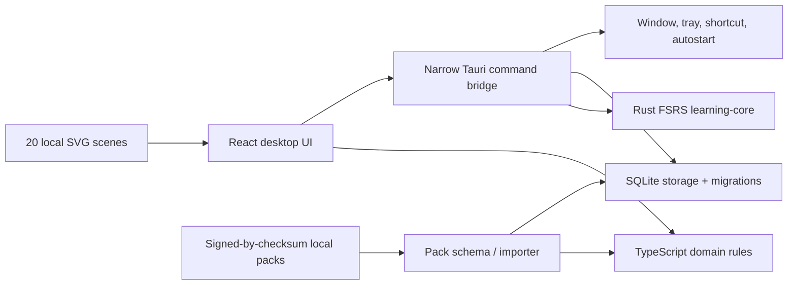

# Architecture

## System boundary

No component in the core loop requires a server. The only operating-system data
source outside application storage is the clipboard, and it is behind a single-use
explicit-shortcut gate.

## Workspace responsibilities

| Area                   | Responsibility                                                                | Must not own                  |
| ---------------------- | ----------------------------------------------------------------------------- | ----------------------------- |
| `packages/domain`      | identities, fusion, scaffold, confusion, rescue, budgets, deterministic queue | React, files, network, SQLite |
| `packages/pack-schema` | schemas, bounded catalog loading, checksum, CSV/JSON CLI, diff                | user review state             |
| `packages/ui`          | data-driven motion presentation and reduced-motion fallback                   | scheduling or storage         |
| `crates/learning-core` | official `fsrs` crate adapter and UTC scheduling                              | window/UI behavior            |
| `crates/storage`       | migration, transactions, indexes, backup/delete primitives                    | React state                   |
| `crates/platform`      | testable screen/window policies                                               | vocabulary semantics          |
| `apps/desktop`         | accessible composition and narrow Tauri commands                              | duplicate domain algorithms   |

## Identity and data ownership

`Lexeme` represents a spelling/form. `WordSense` represents one meaning, identified
by normalized lemma + part of speech + author-controlled semantic sense key. Packs
join senses through many-to-many memberships. A user review is attached to a sense
card/direction, never to a bare spelling. This is why two packs can share `adapt`
in the same sense while `bank` as a financial institution and `bank` as a river
edge remain separate.

Bundled content tables and personal tables are separated by foreign keys. Removing
one pack membership cannot delete another pack's membership or personal progress.
Pack aliases provide an explicit upgrade path when authors intentionally replace an
ID; silent heuristic remapping is forbidden.

## Persistence

SQLite is authoritative in Tauri. Migration 1 defines normalized content, learning,
attention, import, window, and provenance tables with due/confusion/history indexes.
The current UI adapter also stores one bounded JSON state snapshot in
`user_settings.settings_json`, transactionally, to make the React/native boundary
atomic while normalized repository methods mature independently. Pack import,
review commits, and delete-all are transaction-scoped Rust operations.

The browser development preview uses the same state shape in localStorage. It is
not the native release storage implementation and does not run Rust FSRS.

## Desktop behavior

Compact and Dot show paths use transparent frameless windows with native rectangular
shadows disabled, and temporarily mark the window non-focusable before show, then
restore focusability for later deliberate input. A compact-card `ResizeObserver`
reports content width and height through a bounded native command, so the
operating-system window tracks both the selected card size and its content without
leaving a large invisible click-blocking rectangle; the native adapter clamps both
dimensions to the current monitor work area. Same-schema persisted preferences are
merged with current defaults, so older snapshots safely receive the Standard/Violet
card and the disabled hint mode.
Expanded/onboarding mode uses the standard operating-system frame, is resizable from
every edge, fits the current monitor work area, and may focus only after a user action.
Native close is intercepted, hides the window, records snooze, and emits a UI event; it
never calls delete. Positions are keyed by display geometry and clamped when restored to
a changed work area.

Tray commands are Pause, Next, Open, and Quit. `Ctrl+Shift+V` authorizes one clipboard
read for three seconds. Autostart defaults off. There is no shell or HTTP capability.

## Failure strategy

- Invalid content fails before mutation; transactions roll back on any row error.
- Unknown fullscreen state fails closed for ambient appearance and is not polled.
- Missing voice, image, or motion support produces a text fallback.
- Invalid/outdated backup schemas produce a named error instead of best-effort data
  corruption.
- Native command failures log only the command name/error, never clipboard or source
  text, and leave the local UI usable.
